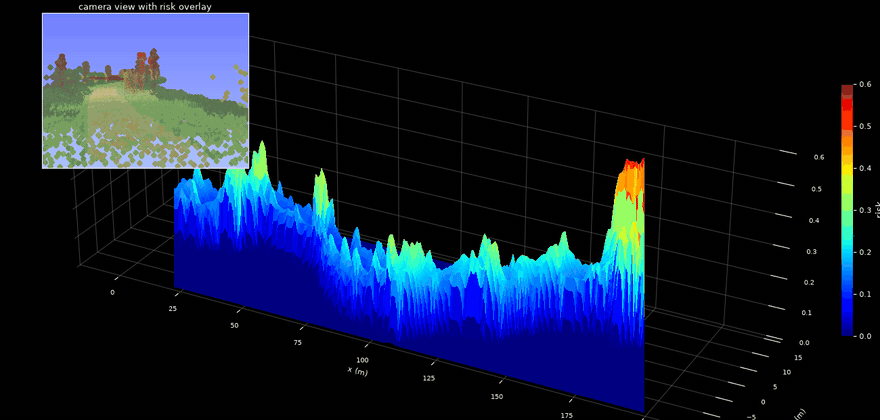

[Full-quality video (mp4)](docs/demo.mp4)

# trail-hazard-map

## Trail danger map (open `web/index.html`)

Pick a real Rhode Island trail from the dropdowns, or type a trail name and press Search. You get:

- the trail drawn on real 3D terrain with satellite imagery, colored green to red by danger (with a soft heat glow);
- a side-by-side walk-through view of the same terrain, with a Play button and a position slider;
- an elevation profile colored by danger, plus stats (length, climb, max grade, mean danger, worst 100 m) and a "jump to worst spot" button.

Trails ship for Lincoln Woods, Neutaconkanut Hill, Diamond Hill, Snake Den and the Blackstone gorge trunkline trail (OpenStreetMap, ODbL). Search also queries OpenStreetMap live for any other named trail in Rhode Island. It needs internet (map tiles, terrain tiles).

How danger is computed here: from 10 m elevation data along and beside the trail: grade (40%), side drop-off within 10 m (35%) and ruggedness, meaning how fast the grade changes (25%), each scaled to 0-1. It is a terrain-based estimate and not a safety guarantee. It does not use computer vision, so it relaxes the "pixels only" rule from the original plan. The camera view is a rendered terrain view, not street photos.

## Computer-vision pipeline demo

`pip install -e .[dev]` then `trail-hazard-map demo` runs the CPU-only pipeline on a synthetic splat: quality filter, Harris + RANSAC two-view baseline, multi-view fusion, geometry, scoring, heat recoloring and a flythrough. Mapillary, VGGT, gsplat and Grounded-SAM-2 are stubbed with simulated predictions, so its metrics are against injected ground truth. `trail-hazard-map run` exits with an explanation until the GPU stack is wired in.

Regenerate the README clip with `python tools/record_demo.py web/index.html docs <area> <trail> <search> <area2> <trail2>` (needs playwright and Chrome). Rebuild trail data with `tools/build_trails.py`.
